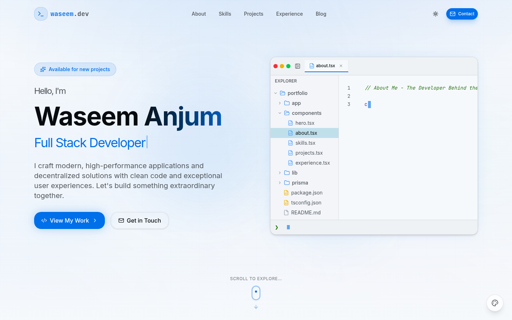
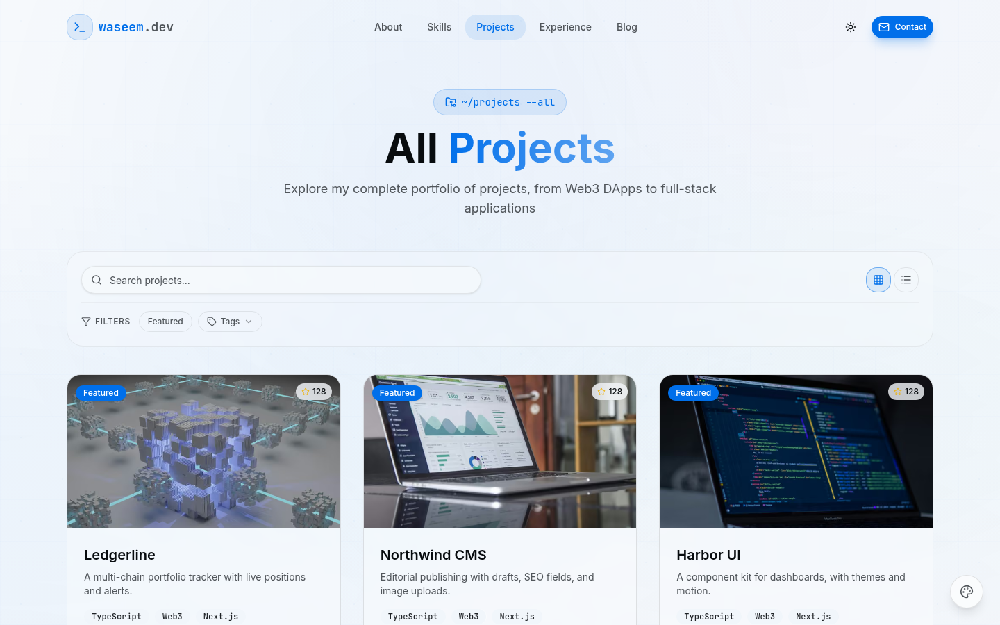
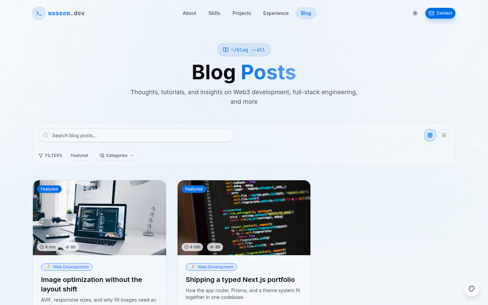

# Next.js Portfolio & Blog Platform

[](https://github.com/fabwaseem/nextjs-portfolio-website/actions/workflows/ci.yml)


A full-stack portfolio and blog you can run as your own site. It ships with a VS Code-inspired public layout, an admin dashboard, **218 themes**, PostgreSQL via Prisma, and optional AI writing, S3 uploads, and email.

[Live demo](https://fabwaseem.vercel.app) · [Themes](THEMES.md) · [Issues](https://github.com/fabwaseem/nextjs-portfolio-website/issues)

## Screenshots

| Home | Projects | Blog |
| --- | --- | --- |
|  |  |  |

## Features

- **218 themes** with light and dark variants, switched from the admin settings
- Public portfolio: hero, skills, projects, experience, testimonials, videos, and blog
- Blog and project CMS with drafts, tags, categories, featured flags, and SEO fields
- Admin authentication with Better Auth (magic link and Google)
- Image uploads to S3, compressed in the browser before upload and served through `next/image` (AVIF and WebP)
- Optional OpenAI helpers for blog drafts and project SEO metadata
- Contact form email, YouTube channel videos, sitemap, robots, Open Graph, and JSON-LD
- Security headers on every response (CSP, HSTS, frame, referrer, and permissions policies)

## Stack

| Area | Choice |
| --- | --- |
| App | Next.js 16 App Router, React 19, TypeScript |
| UI | Tailwind CSS 4, Radix UI, Framer Motion, GSAP |
| Data | PostgreSQL, Prisma 7, Zod |
| Auth | Better Auth |
| Media | AWS S3, Sharp, `next/image` |
| Optional | OpenAI, Nodemailer, YouTube |

## Quick start

Node.js **20.9+** and a PostgreSQL database. S3, SMTP, and OpenAI are optional.

```bash
git clone https://github.com/fabwaseem/nextjs-portfolio-website.git
cd nextjs-portfolio-website
cp .env.example .env
```

Set `DATABASE_URL` and `BETTER_AUTH_SECRET` in `.env` (a long random string). Then:

```bash
npm install
npm run db:migrate
npm run create-admin
npm run dev
```

Open [http://localhost:3000](http://localhost:3000). The admin login is at `/admin/login`.

| Variable | Required | Purpose |
| --- | --- | --- |
| `DATABASE_URL` | Yes | PostgreSQL connection string |
| `BETTER_AUTH_SECRET` | Yes | Session signing secret |
| `NEXT_PUBLIC_BASE_URL` | Yes | Canonical site URL |
| `NEXT_PUBLIC_BETTER_AUTH_URL` | Yes | Auth base URL, usually the same origin |
| `AWS_*` | For uploads | S3 bucket, region, and keys |
| `SMTP_*` | For email | Contact form and magic links |
| `OPENAI_API_KEY` | No | AI blog and SEO helpers |
| `GOOGLE_CLIENT_ID` / `GOOGLE_CLIENT_SECRET` | No | Google sign-in |

## Scripts

| Command | What it does |
| --- | --- |
| `npm run dev` | Development server |
| `npm run build` | Apply migrations, then production build |
| `npm start` | Start the production server |
| `npm run lint` | ESLint |
| `npm run typecheck` | `tsc --noEmit` |
| `npm run db:migrate` | `prisma migrate deploy` |
| `npm run db:generate` | Regenerate the Prisma client |
| `npm run create-admin` | Create an admin user |

GitHub Actions (`.github/workflows/ci.yml`) runs lint, typecheck, and the production build against PostgreSQL 16.

## Project structure

```
app/                 App Router pages, metadata routes, and API handlers
components/          Public layout, admin, and UI primitives
lib/themes/          218 theme definitions and the theme provider
prisma/              Schema and migrations
docs/screenshots/    README screenshots
```

## Security

Responses set `Content-Security-Policy`, `Strict-Transport-Security`, `X-Frame-Options`, `X-Content-Type-Options`, `Referrer-Policy`, and `Permissions-Policy`. `X-Powered-By` is disabled. API input is validated with Zod, and database access goes through Prisma. Put secrets in the environment, not in the repo.

## Deploy

Import the repo on [Vercel](https://vercel.com/new/clone?repository-url=https://github.com/fabwaseem/nextjs-portfolio-website), add the environment variables, and deploy. The build command `npm run build` applies migrations before `next build`.

The same build works on any Node 20 host that can reach PostgreSQL: Netlify, Railway, Render, or a container. Set the env vars, then use `npm run build` and `npm start`.

## Contributing

1. Fork and create a branch.
2. Commit with [Conventional Commits](https://www.conventionalcommits.org/) (`feat:`, `fix:`, `docs:`).
3. Open a pull request. CI must pass.

## License

[MIT](LICENSE) © 2026 Waseem Anjum

## Author

**Waseem Anjum** — [waseemanjum.com](https://waseemanjum.com) · [GitHub](https://github.com/fabwaseem) · [LinkedIn](https://linkedin.com/in/fabwaseem)
